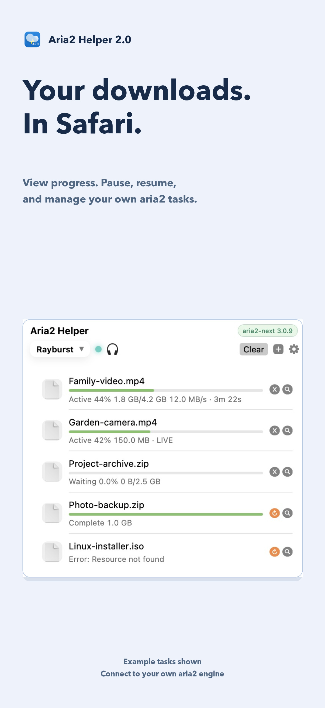
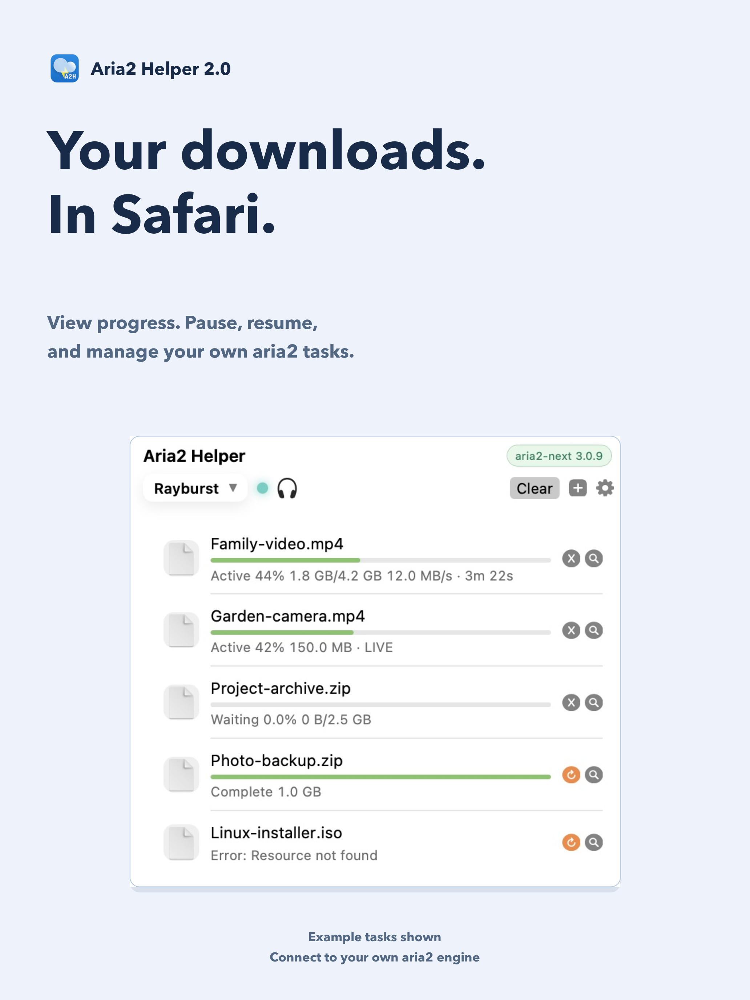

# Aria2 Helper

A Safari extension for managing downloads on your own [aria2](https://aria2.github.io/)
JSON-RPC engine, including [aria2-next](https://github.com/AnInsomniacy/aria2-next)
and compatible engines bundled with Rayburst or Motrix.

Send links, import torrents and Metalink files, and manage tasks from Safari on Mac, iPhone and iPad.
**A running download engine is required.** The app does not include an engine or a hosted download service.

[Download on the App Store](https://apps.apple.com/app/aria2-helper/id6742623503)
· [中文介绍](#中文介绍)
· [All screenshots](docs/PREVIEWS.md)
· [Development guide](docs/DEVELOPMENT.md)
· [Privacy policy](https://github.com/wxmvv/Aria2Helper-for-Safari/wiki/Privacy-Policy)

Version **2.0.0 (31)** was submitted for macOS and iOS/iPadOS on 15 November 2026
and is waiting for App Review. See [release records](release/CONNECT-STATUS.md).

## Preview

### Mac

[](docs/images/2.0/macos/en-US/01-tasks.jpg)

### iPhone and iPad

| iPhone | iPad |
| --- | --- |
| [](docs/images/2.0/ios/en-US/01-tasks.jpg) | [](docs/images/2.0/ipados/en-US/01-tasks.jpg) |

[Browse all 18 English and Chinese previews](docs/PREVIEWS.md), including importing and connection setup.
Images show the current extension interface with labelled example tasks and links; speeds are illustrative.

## Features

- **Manage tasks in Safari.** View progress, speed and errors; pause, resume, restart or remove tasks.
  Reveal downloaded files in Finder when the engine runs locally on your Mac.
- **Import links and files together.** Paste multiple URLs or magnet links and import several
  `.torrent`, `.metalink` or `.meta4` files. Select individual torrent files before downloading.
- **Save multiple connections.** Configure RPC profiles, test connections and switch engines.
  Mac setup includes discovery on common local RPC ports.
- **Choose what to forward.** Configure file-type filters and separate Cookie/Referer forwarding controls.
  Automatic webpage link interception is off by default.
- **Use compatible engines.** Supports classic aria2 and aria2-next, with engine/version information
  and capability detection.
- **Try experimental appearance options.** Liquid Glass surfaces and the popup background tint
  are independent settings, both off by default. Native launch screens use standard system backgrounds.
- **Use English or Simplified Chinese.** Both languages are included in the extension and settings.

## Requirements

- macOS 12 or later, or iOS/iPadOS 15 or later; Safari 16.4 or later.
- An aria2-compatible JSON-RPC engine reachable from the device using the extension.
- RPC access configured on the engine, including a secret and allowed extension requests
  (`rpc-allow-origin-all=true` for aria2).

On **iPhone and iPad**, use the reachable LAN or HTTPS address of an engine on another computer
or server. `127.0.0.1` refers to the phone or tablet itself. Downloads are stored on the engine
machine, rather than directly in the iOS Files app. Local engine discovery and Finder actions
are intended for Mac.

## Get started

1. Install Aria2 Helper and enable it in **Safari Settings → Extensions**.
   On iPhone/iPad, open **Settings → Apps → Safari → Extensions**
   (Safari appears directly in Settings on older OS versions).
2. Grant access to the websites where you want to use the extension.
3. Open Aria2 Helper from Safari's toolbar or extensions menu, then open its settings.
4. Enter the engine host, port and RPC secret, test the connection, and save the profile.
5. Add links or import files from the popup. Enable **Intercept download links** if you want
   supported webpage links sent to the engine automatically.

For a local Mac engine, install aria2 from its [official project](https://aria2.github.io/)
or an existing Homebrew installation (`brew install aria2`). Run it with RPC enabled and a secret.
Use HTTPS across untrusted networks, and keep RPC access limited to trusted devices.

### Connecting to Rayburst on Mac

1. Open Rayburst settings, enable RPC and copy the **RPC secret**. Its usual port is `29100`.
2. Open Aria2 Helper settings → **Get started → Scan local engines**.
3. Pick the engine, paste the secret, then test and save the connection.

## Privacy

Connection settings are stored in the extension's local browser storage. Download requests and
RPC credentials are sent to the engine you configure. Cookie and Referer forwarding are **on by default**
and can be disabled separately; forwarded values may be used by the engine as download request headers.
Only use engines and download sources you trust.

The app has no developer-operated analytics, advertising or download backend.
Read the [privacy policy](https://github.com/wxmvv/Aria2Helper-for-Safari/wiki/Privacy-Policy)
for storage, permissions and deletion details. Download only content you are authorized to access.

## 中文介绍

Aria2 Helper 是一款 Safari 扩展，可在 Mac、iPhone 和 iPad 上管理自己配置的 aria2 下载引擎。
支持查看和操作任务、批量添加链接、导入种子与 Metalink，以及选择种子内需要下载的文件。

使用前需单独运行 aria2 兼容引擎；本 App 不包含引擎，也不提供下载托管服务。
iPhone/iPad 应连接另一台电脑或服务器的可访问地址，下载文件保存在引擎所在设备。
自动链接拦截和两个实验性外观选项默认关闭；Cookie、Referer 转发默认开启，可分别关闭。

[查看中英文预览图](docs/PREVIEWS.md#简体中文)
· [开发与调试](docs/DEVELOPMENT.md)
· [隐私政策](https://github.com/wxmvv/Aria2Helper-for-Safari/wiki/%E9%9A%90%E7%A7%81%E6%94%BF%E7%AD%96)
· [问题反馈](https://github.com/wxmvv/Aria2Helper-for-Safari/issues)

## Development

```sh
npm run setup          # install settings dependencies from the lockfile
npm run dev            # settings hot reload with a mocked extension API
npm run debug:macos    # build the settings bundle and native Mac debug app
npm test               # core unit and regression tests; no engine required
npm run lint:settings
npm run build:settings # production bundle for the extension
npm run release:check
```

The development server listens at <http://127.0.0.1:5173/>. Use `npm run dev:ui` for the
popup/static settings harness at <http://127.0.0.1:8123/popup.html>.
Mock pages use example data; actual extension permissions and downloads need testing in Safari.

See the [development guide](docs/DEVELOPMENT.md) for Xcode signing, Safari Web Inspector,
iOS debugging and real-engine integration tests. The [architecture notes](docs/ARCHITECTURE.md)
describe the RPC client, storage migration and message API.

### Project layout

```text
Shared (Extension)/Resources/  extension scripts, shared core and built settings
Shared (App)/                 native macOS/iOS container
settings/                     React settings source
tests/                        unit, integration and UI harnesses
docs/                         architecture, development and preview images
release/                      App Store metadata, review guide and release records
scripts/                      debug builds and App Store artifact checks
```

The internal Xcode product name is `Aira2Helper`; the App Store name is **Aria2 Helper**.
For archive/export commands and package validation, see the [release guide](release/README.md).

## License

[MIT](LICENSE)
