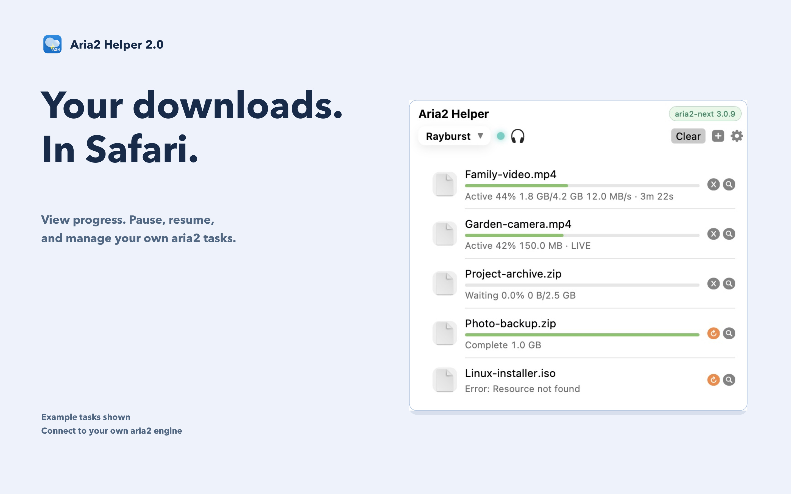

# Aria2 Helper

**English** · [简体中文](README_CN.md)

Manage your own [aria2](https://aria2.github.io/) downloads from Safari on Mac, iPhone and iPad.
Send links, import torrents and Metalink files, and control tasks without leaving the browser.
Supports classic aria2, [aria2-next](https://github.com/AnInsomniacy/aria2-next), and compatible
engines bundled with Rayburst or Motrix.

[](https://apps.apple.com/app/aria2-helper/id6742623503)

[Report an issue](https://github.com/wxmvv/Aria2Helper-for-Safari/issues)
· [Development guide](docs/DEVELOPMENT.md)
· [Privacy policy](docs/PRIVACY.md)

## Preview

[](docs/images/2.0/macos/en-US/01-tasks.jpg)

The current 2.0 interface with example tasks; displayed speeds are illustrative.

## Features

- **Task management:** view progress, speed and errors; pause, resume, restart or remove tasks.
  Reveal downloaded files in Finder when the engine runs locally on your Mac.
- **Batch importing:** add multiple URLs or magnet links and import `.torrent`, `.metalink` or
  `.meta4` files. Select individual torrent files before downloading.
- **Multiple engines:** save RPC profiles, test connections and switch engines.
  Mac setup can discover engines on common local RPC ports.
- **Download controls:** filter file types and configure Cookie/Referer forwarding separately.
  Automatic webpage link interception is off by default.
- **Experimental appearance:** Liquid Glass surfaces and popup background tint are independent
  options, both off by default.
- **Two languages:** English and Simplified Chinese.

## Requirements

- macOS 12 or later, or iOS/iPadOS 15 or later; Safari 16.4 or later.
- A running aria2-compatible JSON-RPC engine reachable from your device. **The app does not include
  an engine or a hosted download service.**
- RPC enabled with a secret and allowed extension requests (`rpc-allow-origin-all=true` for aria2).

On iPhone and iPad, connect to an engine on another computer or server using its reachable LAN
or HTTPS address. `127.0.0.1` refers to the phone or tablet itself. Downloads are stored on the
engine machine, rather than directly in the iOS Files app. Local engine discovery and Finder
integration are intended for Mac.

## Get started

1. Install Aria2 Helper and enable it in **Safari Settings → Extensions**.
   On iPhone/iPad, open **Settings → Apps → Safari → Extensions**
   (Safari appears directly in Settings on older OS versions).
2. Grant access to the websites where you want to use the extension.
3. Open Aria2 Helper from Safari's toolbar or extensions menu, then open its settings.
4. Enter the engine host, port and RPC secret, test the connection, and save the profile.
5. Add links or import files from the popup. Enable **Intercept download links** if you want
   supported webpage links sent to the engine automatically.

For a local Mac engine, install aria2 from its [official project](https://aria2.github.io/)
or an existing Homebrew installation (`brew install aria2`), then run it with RPC enabled and a secret.
For Rayburst, enable RPC in its settings and copy the secret; its usual RPC port is `29100`.

## Privacy

Connection settings are stored in the extension's local browser storage. Download requests and RPC
credentials are sent to the engine you configure. **Cookie and Referer forwarding are on by default**
and can be disabled separately; your engine may use forwarded values as download request headers.
Use trusted engines and download sources, and HTTPS across untrusted networks.

The app has no developer-operated analytics, advertising or download backend.
Read the [privacy policy](docs/PRIVACY.md)
for details. Download only content you are authorized to access.

## Development

```sh
npm run setup          # install dependencies from the lockfile
npm run dev            # settings hot reload with a mocked extension API
npm run debug:macos    # build the settings bundle and native Mac debug app
npm test               # unit and regression tests; no engine required
npm run lint:settings
npm run build:settings # production settings bundle
```

Development pages use example data. Test actual permissions and downloads in Safari.
The internal Xcode product name is `Aria2Helper`; the App Store name is **Aria2 Helper**.

- [Development and debugging](docs/DEVELOPMENT.md): Xcode signing, Safari Web Inspector and iOS testing.
- [Architecture](docs/ARCHITECTURE.md): RPC, storage and extension messages.
- [App Store releases](release/README.md): archive/export commands, package checks and submission records.

## License

[MIT](LICENSE)
