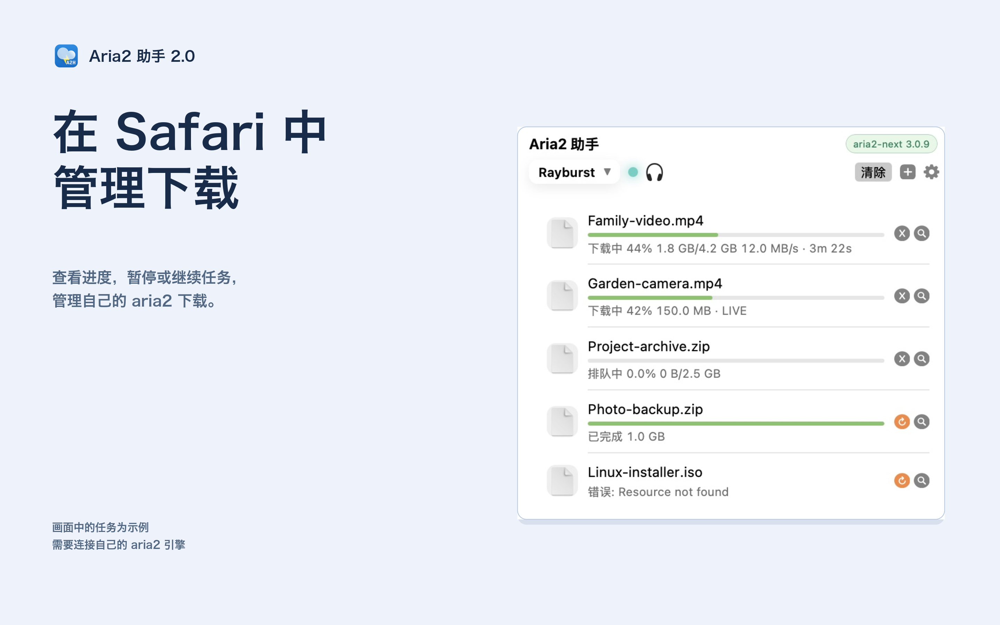

# Aria2 Helper

[English](README.md) · **简体中文**

在 Mac、iPhone 和 iPad 的 Safari 中管理自己的 [aria2](https://aria2.github.io/) 下载任务。
添加链接、导入种子和 Metalink 文件，并在浏览器中查看和操作任务。
支持传统 aria2、[aria2-next](https://github.com/AnInsomniacy/aria2-next)，
以及 Rayburst、Motrix 内置的兼容引擎。

[](https://apps.apple.com/app/aria2-helper/id6742623503)

[问题反馈](https://github.com/wxmvv/Aria2Helper-for-Safari/issues)
· [开发与调试](docs/DEVELOPMENT_CN.md)
· [隐私政策](docs/PRIVACY_CN.md)

## 界面预览

[](docs/images/2.0/macos/zh-Hans/01-tasks.jpg)

当前 2.0 界面，任务及速度为演示数据。

## 功能

- **管理任务：**查看进度、速度和错误，暂停、继续、重新开始或移除任务。
  Mac 连接本机引擎时，可在 Finder 中定位下载文件。
- **批量导入：**一次添加多个网址或磁力链接，导入 `.torrent`、`.metalink`、`.meta4` 文件，
  并在添加种子前选择其中需要下载的文件。
- **连接多个引擎：**保存 RPC 配置、测试连接、切换引擎。Mac 配置引导支持扫描常见本机 RPC 端口。
- **控制下载行为：**配置文件类型过滤规则，分别控制 Cookie 和 Referer 转发。网页链接自动拦截默认关闭。
- **实验性外观：**液态玻璃效果与弹窗渐变底色为两个独立选项，默认均关闭。
- **双语界面：**支持英文与简体中文。

## 使用要求

- macOS 12 或更新版本，或 iOS/iPadOS 15 或更新版本；Safari 16.4 或更新版本。
- 设备能够访问的 aria2 兼容 JSON-RPC 引擎。**本 App 不包含下载引擎，也不提供下载托管服务。**
- 引擎开启 RPC、配置密钥并允许扩展请求；aria2 对应选项为 `rpc-allow-origin-all=true`。

iPhone 和 iPad 需要连接另一台电脑或服务器上的引擎，使用设备可访问的局域网地址或 HTTPS 地址。
`127.0.0.1` 指的是手机或平板自身。下载文件保存在引擎所在设备上，而非直接保存到 iOS“文件”App。
本机引擎扫描和 Finder 集成功能适用于 Mac。

## 开始使用

1. 安装 Aria2 Helper，在 **Safari 设置 → 扩展** 中启用。
   iPhone/iPad 请打开 **设置 → App → Safari → 扩展**；较旧系统中 Safari 直接位于设置列表。
2. 授予需要使用扩展的网站访问权限。
3. 从 Safari 工具栏或扩展菜单打开 Aria2 Helper，再进入设置。
4. 填写引擎主机地址、端口和 RPC 密钥，测试连接并保存配置。
5. 在弹窗中添加链接或导入文件。如需自动接管支持的网页下载链接，可开启“拦截下载链接”。

Mac 本机引擎可从 [aria2 官方项目](https://aria2.github.io/) 获取，
或通过已经安装的 Homebrew 执行 `brew install aria2`，然后开启 RPC 并设置密钥。
使用 Rayburst 时，在其设置中启用 RPC 并复制密钥；常用 RPC 端口为 `29100`。

## 隐私

连接设置保存在扩展的浏览器本地存储中。下载请求和 RPC 凭据会发送给你配置的引擎。
**Cookie 和 Referer 转发默认开启**，可分别关闭；引擎可能将转发的信息作为下载请求头发送到目标网站。
请使用信任的引擎和下载来源，在不受信任的网络上通过 HTTPS 连接。

开发者不为本 App 运营统计、广告或下载后端。详情见
[隐私政策](docs/PRIVACY_CN.md)。
请只下载有权访问的内容。

## 开发

```sh
npm run setup          # 根据 lockfile 安装依赖
npm run dev            # 设置页热更新，使用模拟扩展 API
npm run debug:macos    # 构建设置页与原生 Mac 调试 App
npm test               # 单元与回归测试，无需下载引擎
npm run lint:settings
npm run build:settings # 正式设置页构建
```

开发预览使用示例数据；真实权限与下载行为需要在 Safari 中验证。
Xcode 内部产品名为 `Aira2Helper`，App Store 名称为 **Aria2 Helper**。

- [开发与调试](docs/DEVELOPMENT_CN.md)：Xcode 签名、Safari Web Inspector 和 iOS 测试。
- [项目架构](docs/ARCHITECTURE.md)：RPC、存储与扩展消息。
- [App Store 发布](release/README.md)：归档、导出、产物校验和提交记录。

## 许可证

[MIT](LICENSE)
