# Aria2 Helper 2.0 previews

[Back to README](../README.md)

Current 2.0 extension UI rendered in Safari, with example tasks and links. Speeds are illustrative.
The two experimental appearance options are off. Mobile connection previews use an example LAN address; no server was contacted.

Images are stored in this repository. Select an image to open its full-resolution JPEG.

## English

### Mac

| Tasks / 任务 | Import / 导入 | Connection / 连接 |
| --- | --- | --- |
| [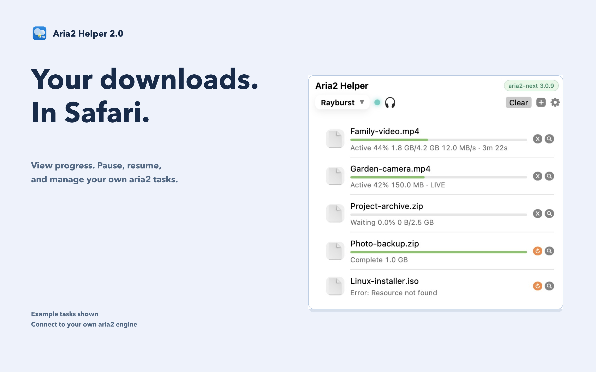](images/2.0/macos/en-US/01-tasks.jpg) | [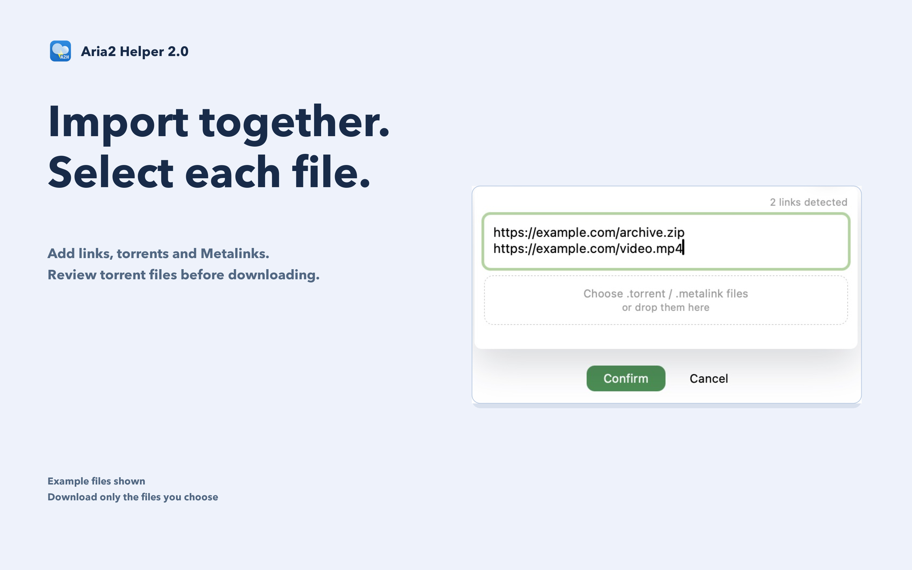](images/2.0/macos/en-US/02-import.jpg) | [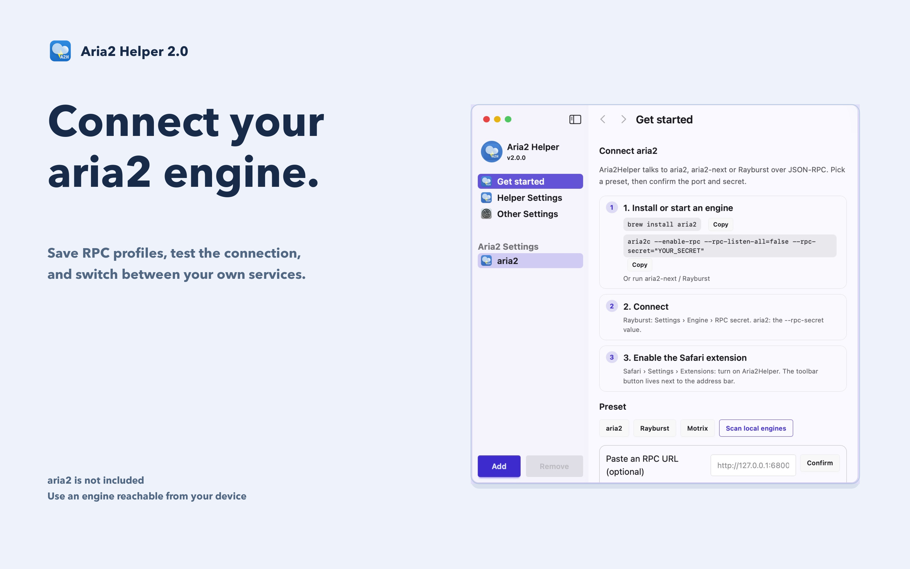](images/2.0/macos/en-US/03-setup.jpg) |

### iPhone

| Tasks / 任务 | Import / 导入 | Connection / 连接 |
| --- | --- | --- |
| [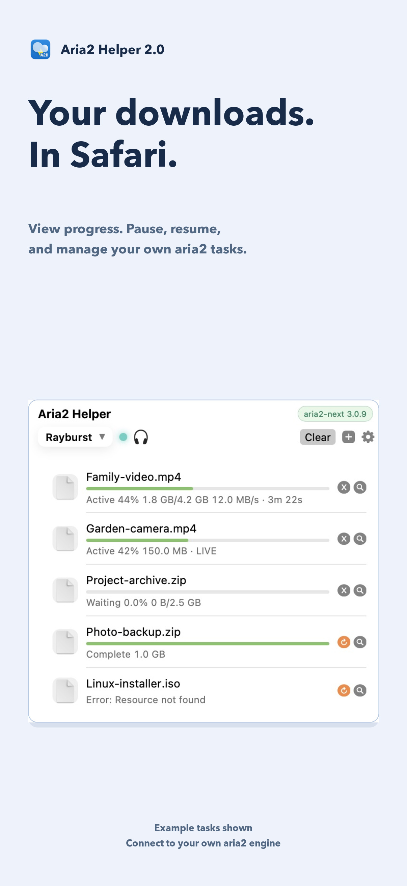](images/2.0/ios/en-US/01-tasks.jpg) | [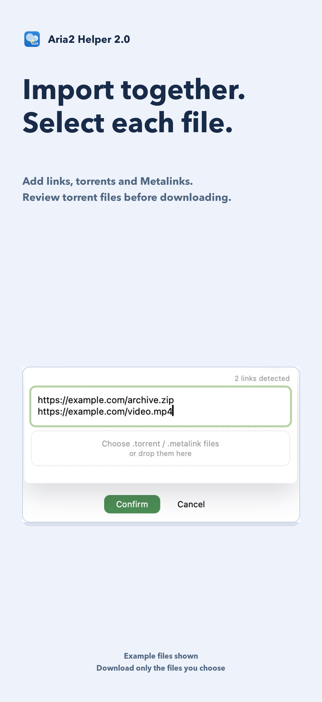](images/2.0/ios/en-US/02-import.jpg) | [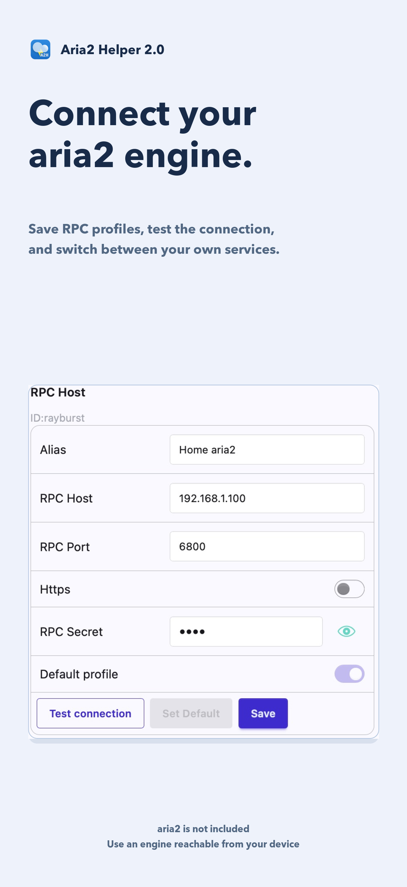](images/2.0/ios/en-US/03-setup.jpg) |

### iPad

| Tasks / 任务 | Import / 导入 | Connection / 连接 |
| --- | --- | --- |
| [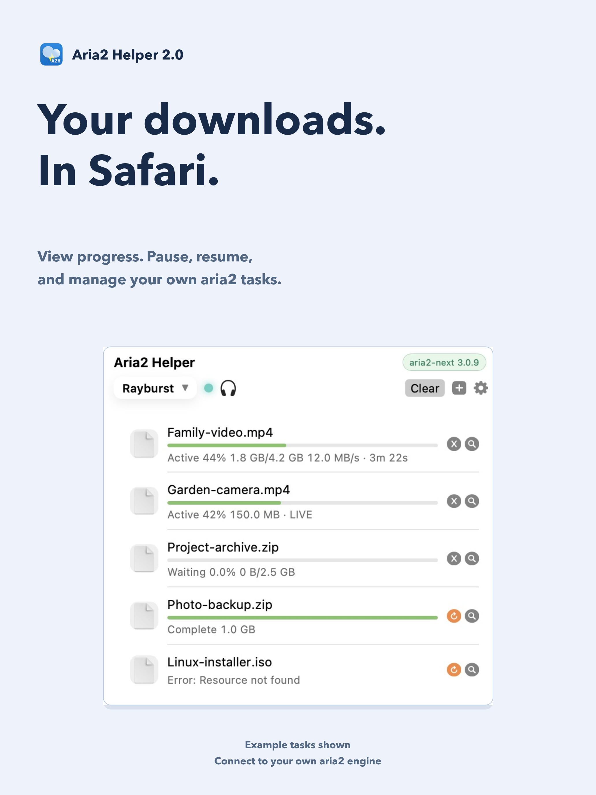](images/2.0/ipados/en-US/01-tasks.jpg) | [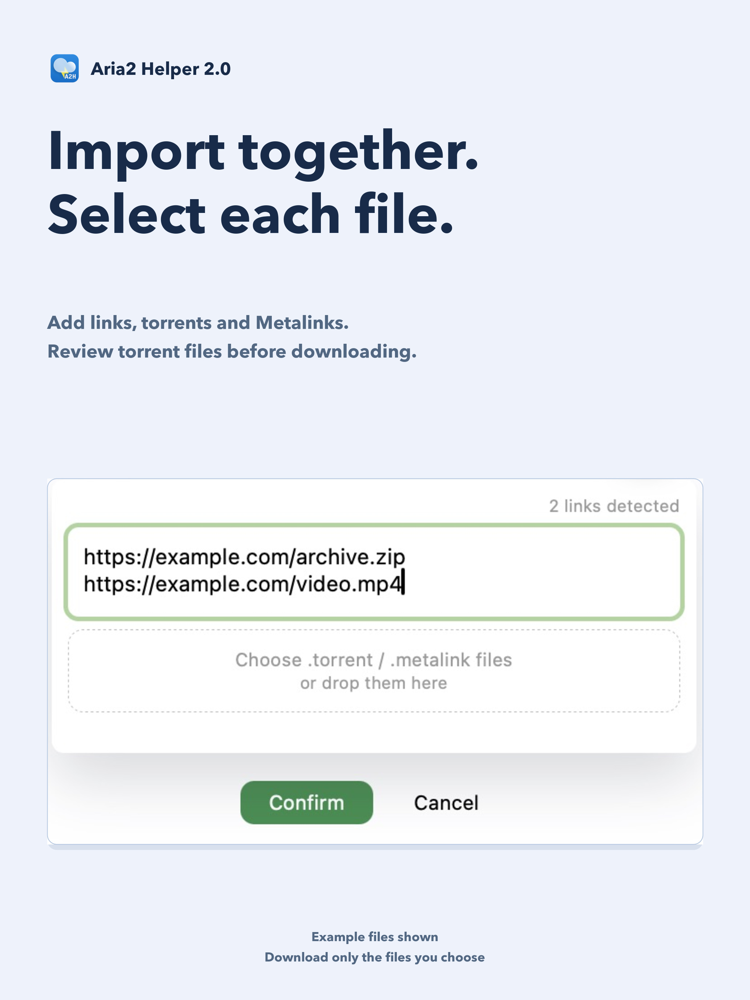](images/2.0/ipados/en-US/02-import.jpg) | [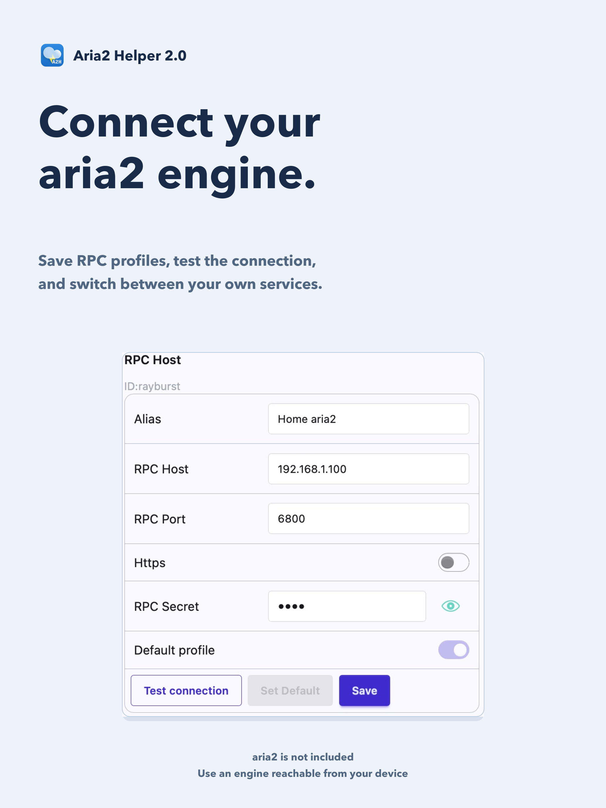](images/2.0/ipados/en-US/03-setup.jpg) |

## 简体中文

以下为当前 2.0 界面的示例画面，任务、链接和速度为示例数据。点击图片可查看原图。

### Mac

| Tasks / 任务 | Import / 导入 | Connection / 连接 |
| --- | --- | --- |
| [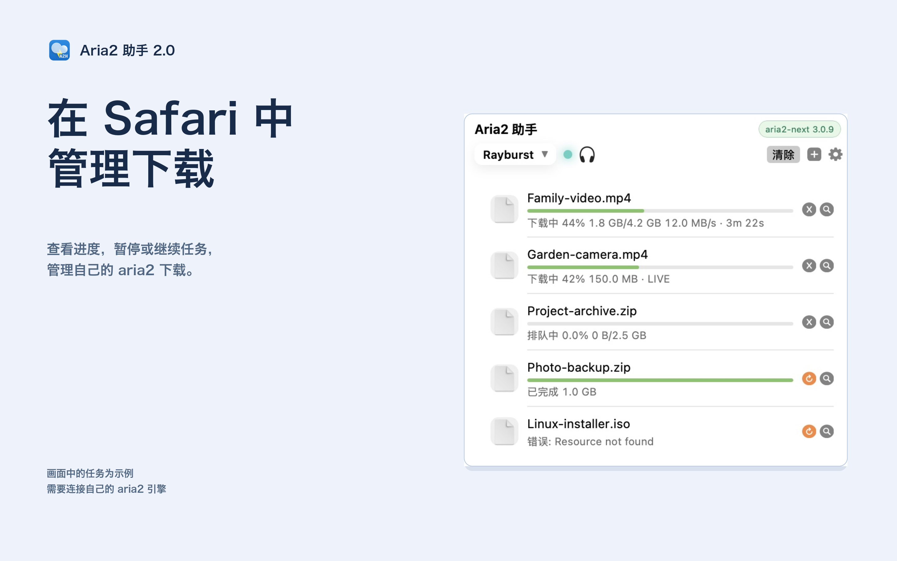](images/2.0/macos/zh-Hans/01-tasks.jpg) | [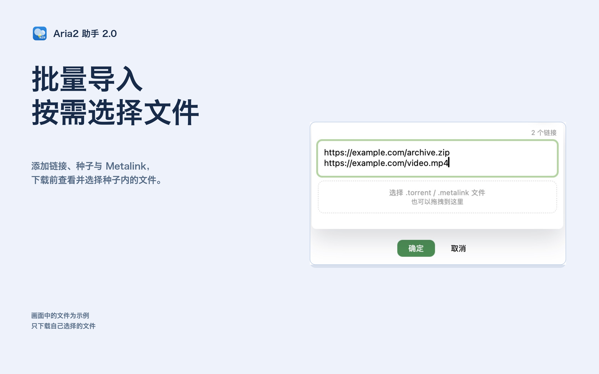](images/2.0/macos/zh-Hans/02-import.jpg) | [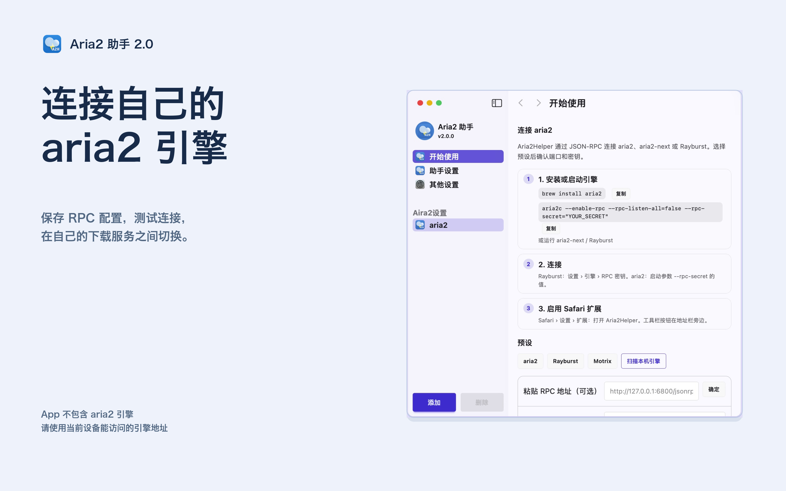](images/2.0/macos/zh-Hans/03-setup.jpg) |

### iPhone

| Tasks / 任务 | Import / 导入 | Connection / 连接 |
| --- | --- | --- |
| [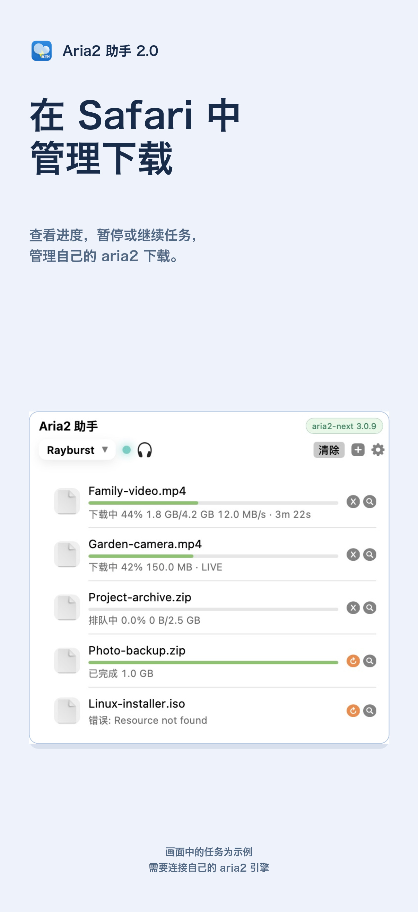](images/2.0/ios/zh-Hans/01-tasks.jpg) | [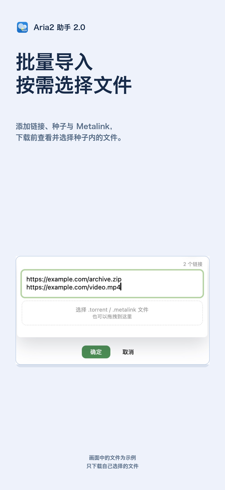](images/2.0/ios/zh-Hans/02-import.jpg) | [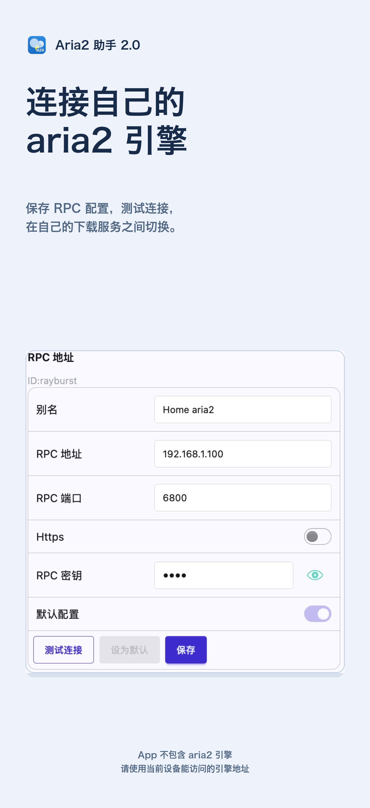](images/2.0/ios/zh-Hans/03-setup.jpg) |

### iPad

| Tasks / 任务 | Import / 导入 | Connection / 连接 |
| --- | --- | --- |
| [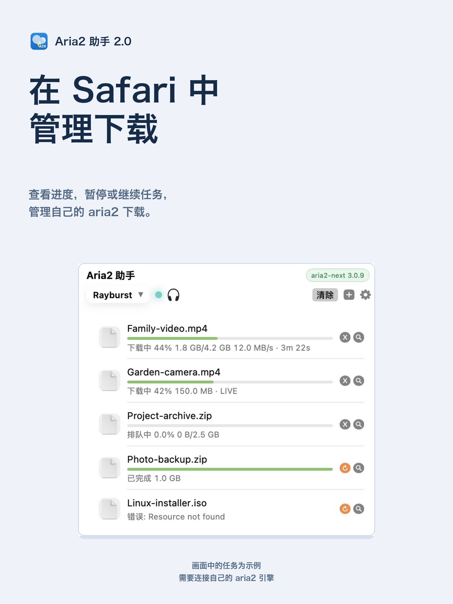](images/2.0/ipados/zh-Hans/01-tasks.jpg) |  | [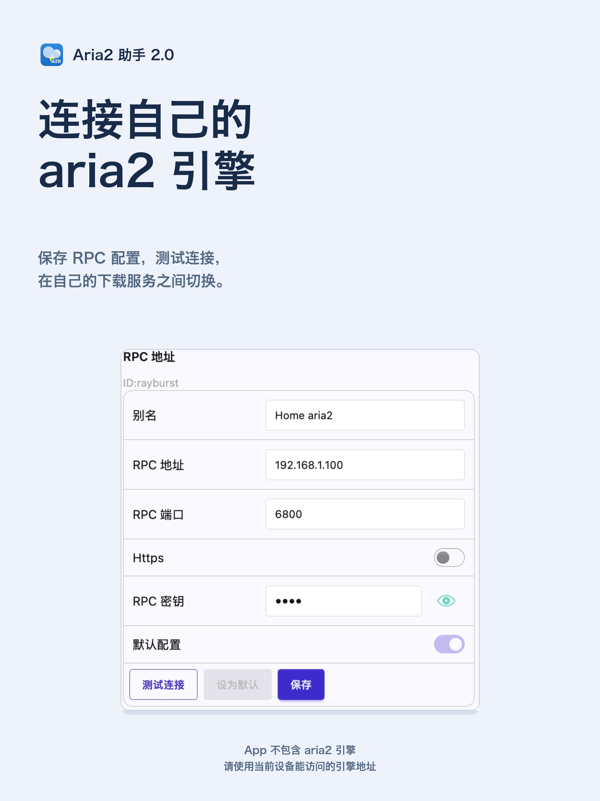](images/2.0/ipados/zh-Hans/03-setup.jpg) |

## Image sources

These are the version 2.0.0 (31) App Store compositions. Source capture notes and the compositor are in
[release/store-assets](../release/store-assets/README.md). The original captures and editable exports are
kept in the release Resource archive; the JPEGs here are ready to view on GitHub and other Git hosts.
